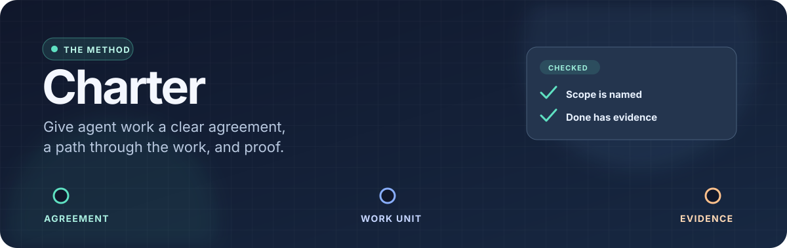
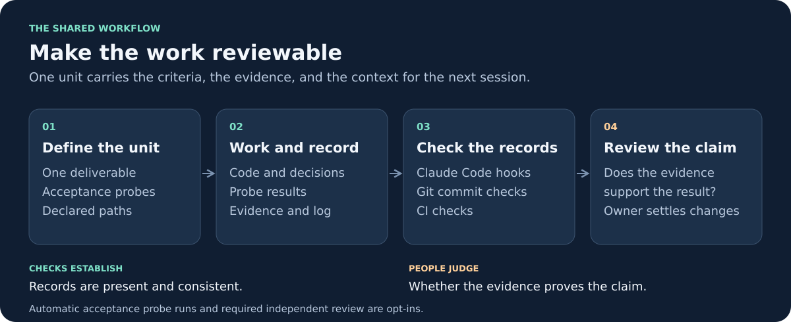

# Charter



**A working method for projects built with coding agents.** Charter puts scope, decisions, work, and proof in the repository. Hooks and CI check the rules at the moments they matter, while a human owner makes the calls that software cannot. [Read the method](docs/method.md) · [See every gate](docs/gates.md)

> **The promise:** a task marked done has checked acceptance criteria and recorded evidence; a change outside the agreed scope has a route back to the owner. The checks make those claims reviewable. They do not judge whether the evidence is true. [How the gates work](docs/gates.md) · [Where they stop](docs/gates.md#what-a-gate-cannot-see)

## The idea, in one picture



| Write it once | What it answers | Who decides |
|---|---|---|
| [`charter/scope.md`](package/charter/templates/scope.md) | What is included in the work? | The owner |
| [`charter/decisions/<id>.md`](package/charter/templates/decision.md) | Why does this design rule exist, and when should it be revisited? | The owner or an independent reviewer |
| [`.taskets/<id>.md`](package/charter/templates/unit.md) | What will this unit change, how will it be checked, and what happened? | The worker records evidence; the reviewer checks it |

A unit names the paths it may touch and the acceptance probes it must run. Charter checks those records in [Claude Code hooks, a git pre-commit hook, and CI](docs/gates.md). Other agent tools still encounter the git and CI checks. The owner controls changes to scope, configuration, and the gates themselves. [Method](docs/method.md) · [Package layout](docs/package.md)

## A work unit in practice

```md
---
status: next
scope: S1
perimeter: [app/**, tests/**]
---

## Acceptance
- [ ] AC-1: checkout behavior works — probe: `python3 -m unittest tests.test_checkout`

## Evidence
- `$ python3 -m unittest tests.test_checkout` → OK
- commit abc1234 resolves the unit

## Log
- Added the checkout case and ran its probe.
```

The example illustrates the flow; use the [unit template](package/charter/templates/unit.md) and [`charter probe`](docs/daily-use.md) for the actual format. A unit cannot be closed as done with unchecked acceptance boxes or without evidence naming a resolving commit or a command that ran. The gate checks that the evidence is present and resolves; a person still evaluates whether it proves the claim. [Done gate](docs/gates.md) · [Evidence rules](docs/method.md)

## Start a project

The [installation guide](docs/install.md) is the single procedure for installing, setting up, upgrading, or removing Charter. It covers two tracks:

- **Client:** scope is tied to an agreed quote or contract, and out of scope paths need an owner approved change request.
- **Prototype:** no scope file is required; the other checks still apply.

From a checkout of this repository, you can inspect a project without changing it:

```sh
python3 bin/charter-pkg survey /path/to/project --track prototype --out /path/to/report
python3 bin/charter-pkg install /path/to/project --track prototype --dry-run
```

For an existing project, start with the survey. For installation, follow [every step in `docs/install.md`](docs/install.md), including the owner handover and setup in each clone. Then use the [daily guide](docs/daily-use.md) for units, probes, decisions, progress, and reviews.

## What is in this repository

| Path | Purpose |
|---|---|
| [`package/`](package/) | Versioned files copied into each project: rules, hooks, CLI, templates, and CI workflow. A package change is a release. |
| [`bin/`](bin/) | Installer, survey, and supporting tools. |
| [`personal/`](personal/) | Optional machine specific Claude Code layer; separate from the project package. |
| [`tests/`](tests/) | Tests for the package and installer. |
| [`docs/`](docs/) | Method, guides, diagrams, design notes, and dated development records. |

**Explore:** [interactive map](docs/charter-map.html) · [method diagrams](docs/method-visual.html) · [desk sheet](docs/cheatsheet.pdf) · [migration paths](docs/migration.md) · [package and upgrade notes](docs/package.md)

## Limits worth knowing

Charter checks repository records and changes. It cannot prove that evidence is truthful, detect every semantic scope change, or authorize an external action such as a deployment. Local hooks can be skipped; CI runs the checks again on a clean clone. Owner protection also depends on repository permissions and review settings outside Charter. [Limits and overrides](docs/gates.md#what-a-gate-cannot-see) · [Method](docs/method.md)

---

Charter grew from trials in real agent driven projects. The dated [reports](docs/report-2026-09-11.md), [reviews](docs/review/), and [trial records](docs/trials/) preserve what was tested and why the rules changed.
